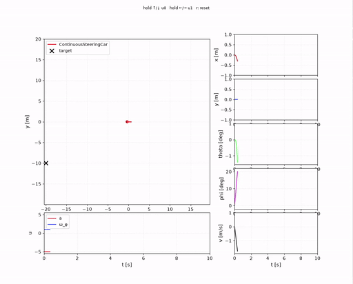
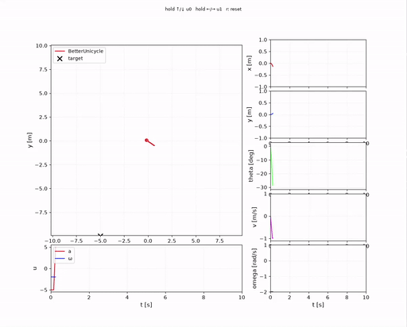
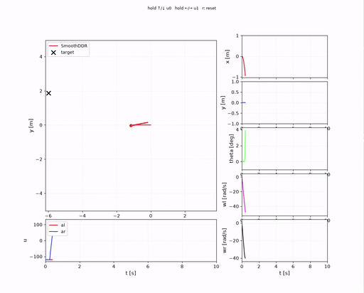
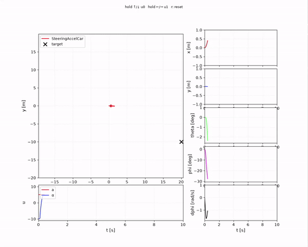

# Simulate, control, and analyze dynamic models

An analytic system to see how a single mobile robot (e.g., a car, DDR, or unicycle) discovers a trajectory based on feedback.


The goal is to make these agents autonomous but we start with a simple Two-Degree of Freedom (2DOF) controller. 

In control theory, a system has two degrees of freedom when you can tune its response to setpoint changes (reference tracking) completely independently from its response to external disturbances and modeling errors. Since feedforward path shapes the tracking results without altering the closed loop poles, it can be tuned without risking stability governed by the PD. This mechanism is pretty similar to residual reinforcement learning, thus in the future this method will be used.

Examples

2DOF | 2DOF (replace this col later) |
| :---: | :---: |
|  |  |
|  |  |

To run a model there is an argument parser:

```bash
python main.py ddr --circle 0 5 5 0.15               # follow a circle: centre x y, radius, rad/s
python main.py unicycle --start -5 3 --heading 90    # start at (-5, 3) facing +y
```